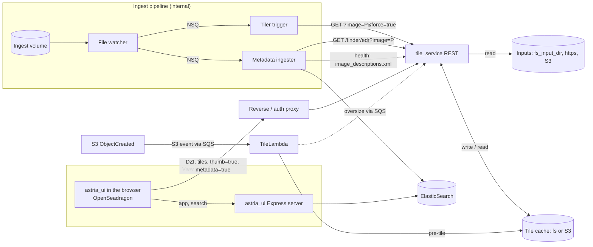

# tile_service architecture

tile_service turns large VICAR and PDS mission images into Deep Zoom (DZI) tile
pyramids, so a browser viewer such as OpenSeadragon can pan and zoom from a
whole-image overview down to single pixels. It stretches 12- and 16-bit science
data to 8 bits, handles gamma, renders geometry products (XYZ, UVW, RNG, ARM,
...) as translucent overlays, and serves thumbnails and per-image metadata. It
is the imagery back end of ASTRIA.

The same page with diagrams is published on the project site (`overview/`).
For testing see [TESTING.md](TESTING.md); for every request parameter and
configuration setting see the [README](../README.md).

## Contents

- [Data flow](#data-flow)
- [Request lifecycle](#request-lifecycle)
- [Inside a DziTask](#inside-a-dzitask)
- [Endpoints](#endpoints)
- [Entry points](#entry-points)
- [Build and deployment profiles](#build-and-deployment-profiles)
- [Security model](#security-model)
- [Source map](#source-map)

## Data flow

Two paths reach tile_service. The ingest path pre-computes tilings as products
arrive, so most views are served from cache. The view path is the ASTRIA web
client (astria_ui) asking for a DZI, its tiles, a thumbnail or the histogram.
Only tile_service and astria_ui are open source; the ingest services,
ElasticSearch and the proxies are deployment components, described here
generically.



### Ingest path

1. New products land on a shared ingest volume. A file watcher publishes create,
   modify and move events to an NSQ channel.
2. A tiler trigger consumes each event and calls
   `GET /image_tiler?image=<path relative to the input root>&force=true`.
   tile_service computes the DZI into its cache. The trigger only logs failures
   and never reads the body.
3. A metadata ingester waits for `/image_tiler/image_descriptions.xml` to answer
   (its health check), then calls `/image_tiler/finder/edr?image=<path>` for
   each file. It merges that metadata (instrument, product type, sol, eye, ...)
   with the VICAR label it parses itself and writes the document to
   ElasticSearch.

Typical on-premises deployments run two tile_service containers over the same
read-only input root and filesystem cache: one serves the web client, one takes
ingest traffic. DZI URL overrides (`dzi_host_override`, `dzi_path_override`)
make the tile URLs inside each DZI point at the public reverse-proxy path.

The path the services send must be relative to `fs_input_dir`. A path with a
leading `/` is rejected as absolute by image requests, and by the finder after
the path-traversal fix, so the ingest services must strip the watch directory
including its trailing separator.

### View path

1. The astria_ui Express server delivers the web app and proxies search to
   ElasticSearch. It does not proxy tile_service in production: the browser
   talks to tile_service directly or through the deployment's reverse or
   authentication proxy, at the configured `tile_service_url`.
2. To show a product, astria_ui (`buildTiledImageURL` in
   `src/utils/osd/osdUtils.js`) builds
   `?image=<url>&format=png&proxy=<proxy>` plus `rdr=`, stretch and
   `overlayPreference=` parameters when the user changes them, and hands it to
   OpenSeadragon as a DZI tile source. The image URL is passed unencoded.
3. OpenSeadragon reads the DZI XML and fetches tiles from the base URL in its
   `Url` attribute, retrying 202 and 404 with backoff while a tiling is still
   being computed.
4. Thumbnails use `&thumb=true`; the stretch and histogram panel uses
   `&metadata=true` (`histogram`, `stretch_low`, `stretch_high`, ...); product
   type descriptions come from `image_descriptions.xml`.

### Cloud variant

With inputs and cache on S3, an S3 upload notification (wrapped in SQS) invokes
`TileLambda`. It pre-tiles the product into the cache bucket with default
settings and deletes the cached tiling when the product is removed. Inputs too
large for a Lambda are forwarded over SQS (`tile_service_queue_name`) to the
REST service. The REST service and the Lambda share the cache bucket and
configuration, so a default request for a pre-tiled product is answered from
cache. Tiles can then be served by redirect to a presigned S3 URL or a data
proxy instead of streaming through the servlet.

## Request lifecycle

Every request goes through `TileService.handleRequest`:

1. **Concurrency gate.** Beyond `tiler_max_concurrent_requests` the request gets
   503.
2. **Route by path.**
   - A tile path `/<hash>[/cfg/<hash>]/<proxy>_proxy_image_files/<level>/<col>_<row>.<fmt>`
     goes to `serveTileImage`. The hash must be 40 hex characters
     (`DziParams.HASH_PATTERN`), otherwise 400.
   - `/finder/*` goes to `Finder`.
   - `/version`, `/image_descriptions.xml`, `/image_config.xml` and
     `/openseadragon.min.js` are static.
   - The root path with `image=` goes to `serveDZI`. Anything else is 400.
3. **Parse parameters (`DziParams`).** Normalises the image URL (`file://PATH`
   is the same as `PATH`; `.VIC` shares a cache entry with `.IMG`), infers the
   product and RDR type from the mission filename (or `rdr=`) through the image
   configuration, decides whether it is an overlay, and whether the options are
   the defaults. Nominal requests are cached under `<sha1 of input>/`, custom
   ones under `<hash>/cfg/<sha1 of options>/`.
4. **Validate the source.** Is the scheme enabled (`enable_s3`, `enable_http`,
   `fs_input_dir`)? Then `DziTask.filterUrl` applies the security filters, which
   `force=true` and `filter=false` cannot disable (see
   [Security model](#security-model)). With filtering on, the mission filters
   (`ignore_subdirs`, `ignore_exts`, quicklook and browse products) apply too.
5. **Auxiliary requests.** `viewer=true` returns the HTML viewer at once.
   `thumb`, `metadata`, `progress` and `error` never start work: they answer from
   a running task or the cache, or return 202 / 404.
6. **Cache lookup.** If a running task owns the hash, serve from it. Otherwise
   check the cache: `cache_type=fs` under `fs_cache_loc`, or `cache_type=s3` in
   the cache bucket. A tiling is complete when `metadata.json` exists; `etag.txt`
   detects a changed source and a stale `progress.txt` is treated as a zombie
   task. `force=true` recomputes.
7. **Process.** A miss queues a background `DziTask` (`processDZI`), bounded by
   `max_concurrent_tasks` and the memory and disk budgets, with an interlock
   (`task_interlock_time`) so two servers sharing a cache do not tile the same
   image. The request waits up to `max_wait_time` / `maxWaitSec`, then returns
   the DZI or 202.
8. **Rewrite and respond.** The DZI `Url` is set for the chosen proxy
   (`setUrlAndServeDZI`): this server over http or https, an S3 or data proxy,
   `tile_url`, or the `dzi_*_override` settings. Exceptions map to status codes:
   bad input 400, missing file 404, S3 errors their own code, timeouts 202,
   anything else 500.

## Inside a DziTask

1. **Open the source.** Local file, http range reads (`HTTPHelper`) or S3
   (`S3Helper`), through an LRU page cache in memory and on disk
   (`LRUCacheImageInputStream`), so large products are read in windows rather
   than loaded whole.
2. **Read the pixels.** `RenderedImageReader` opens VICAR and PDS through
   vicario and JAI; plain PNG, JPEG and TIFF go through ImageIO, large ones in
   tile windows (`TileWindowImage`). Overlay products go through the image
   product library's RDR content classes instead, which produce RGB plus a
   validity mask.
3. **Stretch and mask.** Histogram and extrema, then the stretch to 8 bits, then
   the alpha mask for overlays and CRISP `warped-*` images (masked 0; unmasked
   0.86 for overlays and 1 otherwise), then gamma conversion per `gamma_mode`
   with matching PNG gAMA/sRGB chunks (`PNGChunks`, `PNGChunksExt`).
4. **Build the pyramid.** The bundled pyramidio fork
   (`src/main/java/gov/nist/isg/pyramidio/`) cuts a quadtree of tiles using
   `dzi_parallelism` threads. An archiver writes them to the filesystem
   (`ExtendedDirectoryArchiver`, `FileCachedArchiver`), S3 (`S3Archiver`) or
   memory (`MemCachedArchiver`, with `mem_cache_tiles`, so tiles can be served
   while the task runs).
5. **Finish.** Writes `thumbnail.png`, `params.json` and finally
   `metadata.json`, which marks the tiling complete. A failure writes
   `error.txt`.

```
<cache>/<hash>/                      nominal tiling (cfg/<hash>/ for custom options)
  image.dzi                          DZI XML: TileSize, Overlap, Format, Width, Height
  image_files/<level>/<col>_<row>.png
  thumbnail.png  metadata.json  params.json  etag.txt  progress.txt  [error.txt]
```

## Endpoints

Paths are relative to the servlet context, normally `/image_tiler`.

| Request | Returns |
|---|---|
| `GET ?image=URL` | DZI XML, after computing the tiling if needed (202 if still running when the wait ends) |
| `… &thumb=true` | PNG thumbnail (default height 160) |
| `… &metadata=true` | `metadata.json`: size, data type, histogram, stretch limits, gamma and overlay settings, cache hash |
| `… &progress=true` | Percent complete as text (`100.00` when cached), or 404 |
| `… &error=true` | Error text of a failed tiling, or 404 |
| `… &viewer=true` | HTML page showing the image in OpenSeadragon with its metadata |
| `POST ?image=URL` | Same as GET with options from an `application/json` body (`rdr_url`, `force`, `tile_format`, ...) |
| `GET /<hash>/…_proxy_image_files/L/C_R.png` | One tile, from the running task or the cache (redirect when the cache is S3) |
| `GET /version` | Deployed version, as text |
| `GET /image_descriptions.xml` | Product type descriptions (client and ingest health check) |
| `GET /image_config.xml` | Image type configuration |
| `GET /openseadragon.min.js` | OpenSeadragon, used by the viewer page |
| `GET /finder/solrange` | `{"start":M,"end":N}` |
| `GET /finder/edrs?sol=N` | `[{"edr":PATH,"metadata":{…}}]` for every image EDR of a sol |
| `GET /finder/edr?image=P` | Metadata for one EDR, derived from its path and filename |
| `GET /finder/rdrs?edr=P` | The RDRs derived from an EDR |
| `GET /finder/rdr?image=P` | Metadata for one RDR |
| `GET /finder/label?image=P` | The VICAR label as JSON (system, property and task sections) |

Image request parameters:

| Parameter | Meaning |
|---|---|
| `stretchType` | `auto` (percent, or none for user uploads, quicklooks and EDL cameras), `percent`, `extrema`, `relative`, `none` |
| `stretchLow`, `stretchHigh` | Stretch limits; `extremaStretch=true` is the legacy form of `stretchType=extrema` |
| `gammaMode` | `none`, `passthrough`, `convert`, `lineartosrgb`, `srgbtolinear` |
| `rdr` | Product type id from `image_config.xml` instead of inferring it from the filename |
| `overlayPreference` | Repeatable `TYPE:name=value` overlay option, URL encoded |
| `overlayAlpha`, `unmaskedAlpha`, `maskedAlpha`, `maskBlack` | Alpha values and black masking |
| `format` | `png` (default), `jpg`, `jpeg` |
| `tileSize`, `tileOverlap`, `thumbHeight` | Defaults 254, 1, 160 |
| `proxy` | Where the DZI `Url` points: `http`, `https`, `s3`, `data`, `tile`, `default` |
| `doMonolithic`, `noDZI` | Also write a single full-size image; skip the pyramid |
| `force` | Recompute even if cached, running or failed (security filters still apply) |
| `maxWaitSec` | Wait before answering 202 |
| `filter` | Override `filter_image_urls` for the mission filters |
| `forceCustom` | Treat the options as custom even if they equal the defaults |

## Entry points

| Class | Artifact | Purpose |
|---|---|---|
| `TileService` (HttpServlet) | `image_tiler.war` | REST service on Tomcat, mapped to `/*` |
| `TileCLI` | `image_tiler.jar` (`Main-Class`) | Batch and manual tiling, local or S3 |
| `TileLambda` (`RequestHandler<SQSEvent, String>`) | `image_tiler.jar` | Pre-tiles S3 uploads, deletes tilings of removed objects, forwards oversize inputs over SQS |

All three read the same defaults: servlet init parameters for the REST service,
the upper-case environment variables of the same names for the CLI, the Lambda
and Docker.

```
java -Xmx4g -jar image_tiler.jar -i data/NLG_…J01.IMG -m M20 -fc -cl cache   # tile into a filesystem cache
java -jar image_tiler.jar -i data/ZLF_…J01.IMG -fc -cl cache -st extrema -sl 1000 -sh 3000 -tf jpg -f
java -jar image_tiler.jar -i data/NLG_…J01.IMG -pc                            # print the cache directory (hash)
java -jar image_tiler.jar -h                                                   # every option
```

The CLI allows `..` in local input paths; the servlet does not.

## Build and deployment profiles

| Maven profile | Builds | For |
|---|---|---|
| `jar` (default) | `target/image_tiler.jar` | CLI and Lambda |
| `war-localhost-fscache` | `target/image_tiler.war` | Local Tomcat; relative paths (inputs under `test/`, cache in `test/cache`), finder on, S3 off |
| `war-docker` | `target/image_tiler.war` | Containers; `web.xml` holds `{{ VAR }}` placeholders filled from environment variables by the container entrypoint |
| `stub` (add-on) | either of the above | Builds against `mission-image-stub`, a placeholder with no mission knowledge, instead of the internal `mars` library; used by the public test suite |

Main settings (full list in the README, "REST Service Configuration"):

| Setting | Meaning |
|---|---|
| `cache_type` | `fs` (with `fs_cache_loc`) or `s3` (cache bucket; needs `enable_s3`) |
| `mem_cache_tiles` | Also serve tiles from memory while a task runs |
| `fs_input_dir` | Root that relative image paths and the finder resolve against |
| `enable_s3`, `enable_http` | Allowed input schemes |
| `rdr_url_whitelist_patterns` | Regexes an input must match; empty disables http(s) inputs |
| `mission`, `enable_finder` | Filename conventions (`M20`, `MSL`, `CADRE`) and the finder API |
| `tile_url`, `data_url`, `dzi_*_override` | Rewrite the tile base URL in the DZI to fit the deployment's proxies |
| `max_concurrent_tasks`, `tiler_max_concurrent_requests` | Task pool size and request limit (503 beyond it) |
| `memory_budget`, `disk_budget`, `max_rdr_bytes`, `max_image_bytes` | Resource limits |
| `aws_profile`, `aws_region`, `use_aws_header`, `verify_client_credentials` | S3 credentials: a server profile, or per-request credentials from an authentication proxy |

## Security model

tile_service has no user authentication of its own; deployments put it behind
an authentication proxy. Its job is to make sure a request can only make it
read what the deployment intends.

- **Local paths stay under the root.** Image paths must be relative to
  `fs_input_dir`: `..`, absolute paths (`/…`, `file:///…`) and invalid paths are
  rejected with 400 by `DziTask.filterUrl`. Finder paths are resolved,
  normalised and refused with 400 if they leave the root
  (`TileService.checkExists`).
- **No server-side request forgery.** http(s) inputs must match
  `rdr_url_whitelist_patterns` and resolve only to public addresses
  (`HTTPHelper.isSafeUrl`): loopback, private, link-local, CGNAT, metadata
  service names and IPv6 forms that embed IPv4 are refused. `HTTPHelper.open`
  follows redirects itself and checks every hop, with a hop limit and connect
  and read timeouts.
- **Filters cannot be bypassed.** `force=true` and `filter=false` relax only
  the mission filters, never the security filters or the whitelist.
- **Strict S3 detection.** `S3Helper.isS3Host` matches exact host labels in
  linear time; the authority ends at `/`, `?` or `#`, so a lookalike such as
  `http://x.example?.s3.amazonaws.com/k` is treated as plain https.
- **Validated cache paths.** Tile requests must carry a 40-hex cache hash.
- **Safe output.** Request values are sanitised before they are written to log
  prefixes (`Utils.sanitizeForLog`), and the viewer page percent-encodes request
  values before placing them in HTML and script (`Utils.encodeUnsafeUrlChars`).

Finder path normalisation, log sanitising and viewer encoding come with the
path-traversal and log-forging fix that follows 6.6.0; the other protections
are in 6.6.0. Each protection is covered by `@security` tests (see
[TESTING.md](TESTING.md)). Report vulnerabilities privately rather than in
public issues.

## Source map

`src/main/java/jpl/mipl/mars/tile_service/`:

| File | Role |
|---|---|
| `TileService.java` | Servlet: init parameters, routing, DZI/tile/finder/static serving, task pool |
| `DziParams.java` | Request and option parsing, product type inference, cache hash |
| `DziTask.java` | Tiling task, URL filters, configuration defaults |
| `RenderedImageReader.java`, `TileWindowImage.java` | Reading VICAR/PDS and plain images |
| `LRUCacheImageInputStream.java` | Paged memory and disk cache over the source |
| `HTTPHelper.java`, `S3Helper.java`, `AmazonS3URI.java` | Remote inputs and SSRF checks |
| `*Archiver.java`, `WrappedTileCache.java` | Tile output (filesystem, S3, memory) and JAI tile cache |
| `PNGChunks.java`, `PNGChunksExt.java` | PNG gamma chunks |
| `Finder.java` | Finder API |
| `SimpleImageFileFinder.java` | Minimal file finder handed to the overlay rendering code |
| `TileCLI.java`, `TileLambda.java`, `StressTests.java` | CLI, Lambda, load tests |
| `Utils.java`, `ImageInfo.java` | Shared helpers |

`webapp/` holds the viewer template, OpenSeadragon and the two `web.xml`
variants. `src/main/java/gov/nist/isg/pyramidio/` is the vendored pyramidio
fork.
